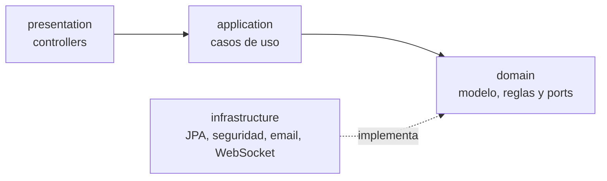

# TurnoYa 💈⏱️

**Citas desde un QR y retraso en directo para pequeños negocios.**

El cliente escanea el QR de la puerta, elige un hueco libre y su cita queda confirmada al momento, sin registrarse ni instalar nada. El día de la cita, su móvil le dice en tiempo real a qué hora le van a atender de verdad: *"Hoy van 15 minutos tarde, llega sobre las 17:15"*.

> 🚧 **En desarrollo activo.** Consulta el [estado del proyecto](#-estado-del-proyecto).

<!-- 👉 Cuando lo tengas, añade aquí el GIF de la demo y el enlace desplegado:

**[Probar la demo](https://tu-enlace.com)**
-->

---

## 🎯 El problema

En peluquerías, talleres o clínicas pequeñas, las citas se gestionan por WhatsApp o en una libreta: el dueño tiene que contestar mensajes mientras trabaja. Y el cliente llega puntual a su cita para encontrarse 30 minutos de espera porque el negocio va retrasado.

## 💡 La solución

| Para el cliente | Para el negocio |
|---|---|
| Reserva en segundos desde un QR, sin crear cuenta | Las citas entran solas, sin contestar mensajes |
| Confirmación por email con enlace a su cita | Agenda del día con botones de Empezar y Terminar |
| Ve en directo si el negocio va con retraso | Puede añadir a mano las citas que le llegan por teléfono |
| Puede cancelar o llamar al negocio con un toque | Ve su retraso acumulado en tiempo real |

## ✨ Lo más interesante técnicamente

- **Cálculo del retraso en cadena.** La hora estimada de cada cita se calcula encadenando la anterior: si la cita de las 10:00 empieza tarde, el retraso se arrastra a las siguientes y se recupera solo si hay huecos libres en medio. Nunca se guarda en base de datos: se calcula al momento.
- **Tiempo real con WebSockets.** Cuando el dueño pulsa "Empezar" o "Terminar", todas las pantallas de los clientes se actualizan al instante.
- **Sin doble reserva, garantizado por la base de datos.** Un índice único parcial en PostgreSQL impide que dos personas reserven el mismo hueco a la vez, aunque las peticiones lleguen en el mismo milisegundo. Las citas canceladas no bloquean su hueco.
- **Privacidad por diseño (RGPD).** Los endpoints públicos nunca exponen datos de otros clientes, y el email y el teléfono se borran cuando la cita termina.

## 🛠️ Stack

| Capa | Tecnologías |
|---|---|
| Backend | Java · Spring Boot 4 · Spring Data JPA · Spring Security + JWT · Spring Mail |
| Tiempo real | WebSockets (STOMP) |
| Base de datos | PostgreSQL 17 · Flyway (migraciones versionadas) |
| Frontend | Angular · Angular Material · PWA |
| Infraestructura | Docker · Docker Compose |
| Tests | JUnit 5 |

## 🏛️ Arquitectura

El backend sigue **Clean Architecture**: el dominio es Java puro y no depende de Spring ni de JPA.



```
src/main/java/com/danielpolanco/turnoya
├── domain/            Modelo y reglas de negocio (Java puro)
│   ├── model/         Negocio, Cita
│   ├── port/          Interfaces que el dominio necesita (repositorios)
│   └── service/       Cálculo de huecos y del retraso
├── application/       Casos de uso y DTOs
├── infrastructure/    Detalles técnicos
│   └── persistence/   Entidades JPA, repositorios, mappers y adapters
└── presentation/      Controllers REST y gestión de errores
```

**Decisiones de diseño:**
- **Modelo de dominio separado de las entidades JPA.** JPA obliga a exponer setters y un constructor vacío; separándolos, el dominio protege sus reglas (por ejemplo, el código del QR de un negocio no puede cambiar nunca). Un mapper traduce entre ambos.
- **Dos formas de construir cada objeto de dominio:** `crear(...)` para objetos nuevos (genera sus identificadores) y un constructor para reconstruirlos desde la base de datos.
- **Identificadores públicos no adivinables (UUID).** Los QR y los enlaces de las citas usan UUID en lugar de ids secuenciales, para que nadie pueda recorrer negocios o cancelar citas ajenas.
- **El cliente no tiene cuenta.** Quien pasa por la calle quiere reservar en segundos. Se le identifica con un token secreto guardado en su navegador y en el enlace del email.
- **Esquema gestionado con Flyway** y Hibernate en modo `validate`: cada cambio en la base de datos queda versionado en Git.

## 🚀 Cómo arrancarlo

**Requisitos:** Java 21+, Docker y Docker Compose.

```bash
# 1. Clonar el repositorio
git clone https://github.com/OnicarN/TURNOYA.git
cd TURNOYA

# 2. Levantar PostgreSQL
docker compose up -d

# 3. Arrancar el backend (Flyway crea las tablas al iniciar)
./mvnw spring-boot:run
```

La API queda disponible en `http://localhost:8085`.

Para ejecutar los tests:

```bash
./mvnw test
```

## 📍 Estado del proyecto

<!-- 👉 Ve marcando las casillas según avances -->

- [x] Diseño del producto y del modelo de datos
- [x] Base de datos en Docker con migraciones Flyway
- [x] Persistencia de `Negocio` con Clean Architecture (modelo, entidad, mapper, port y adapter)
- [ ] Persistencia de `Cita`
- [ ] Cálculo de huecos libres y del retraso, con tests
- [ ] API REST para negocios y clientes
- [ ] Autenticación con JWT
- [ ] Email de confirmación
- [ ] Retraso en tiempo real con WebSockets
- [ ] Frontend en Angular
- [ ] Despliegue

## 🔮 Próximas mejoras

- Recordatorio por email el día antes de la cita
- Varios profesionales por negocio, cada uno con su agenda
- Notificaciones push con la pantalla bloqueada
- Estadísticas para el negocio: puntualidad media, citas por día, ausencias

## 👤 Autor

**Daniel Polanco Mena** · Desarrollador backend Java

[GitHub](https://github.com/OnicarN) · <!-- 👉 [LinkedIn](https://linkedin.com/in/tu-perfil) -->

¿Ideas o sugerencias? Abre un issue o una pull request: las contribuciones son bienvenidas.
